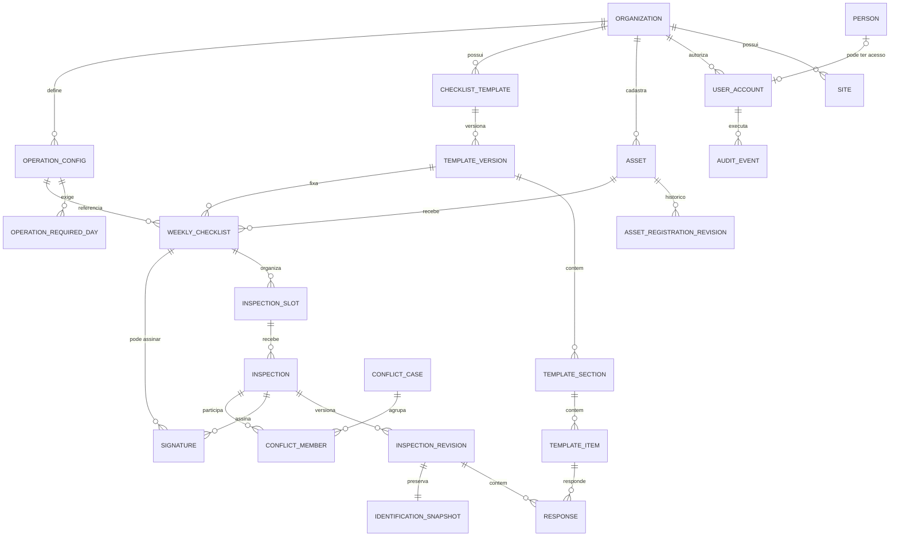

# Arquitetura e regras do sistema

## Decisões de base

- Início da semana: **segunda-feira**.
- Fuso operacional inicial: **`America/Fortaleza`**. Datas de inspeção são `date` nesse fuso; instantes de auditoria e sincronização são armazenados em UTC (`timestamptz`). A organização poderá ter outro fuso configurado no futuro.
- IDs internos: UUID v7 gerados no cliente ou servidor. Números impressos da planilha são apenas `source_printed_number`.
- A versão do modelo é fixada quando o checklist semanal é criado. Publicações posteriores nunca alteram semanas já abertas.
- O backend Next.js é a única camada que acessa o Neon. O Flutter nunca recebe a string de conexão.
- A API segue UTC para instantes e ISO 8601 para datas. O servidor calcula `week_start_date` com o fuso da organização.

## Camadas por funcionalidade

Web e API:

```text
src/features/<feature>/
  domain/          entidades, regras e políticas
  application/     casos de uso e portas
  infrastructure/  Postgres, autenticação, fila e adaptadores
  presentation/    rotas Next.js, DTOs e componentes web
```

Flutter:

```text
lib/features/<feature>/
  domain/
  application/
  data/             API, Drift, mapeadores, repositórios
  presentation/
```

Funcionalidades iniciais: `auth`, `templates`, `assets`, `weekly_checklists`, `inspections`, `sync`, `conflicts`, `audit` e `weekly_view`.

## Modelo de dados



### Cadastros e acesso

| Entidade | Campos principais e regras |
|---|---|
| `organization` | `id`, `name`, `timezone`, `week_starts_on`; escopo obrigatório de todas as consultas |
| `site` | local da operação, arquivável |
| `user_account` | identidade de acesso interna, estado e último login |
| `person` | motorista/operador/supervisor identificado no formulário; não implica conta de acesso |
| `role_assignment` | papel e escopo (`organization`, `site` ou próprio usuário) |
| `asset` | `kind` veículo/equipamento, código interno e estado |
| `asset_registration_revision` | histórico efetivo de placa, marca/modelo, fabricante, ano, cor e propriedade |

### Modelos

| Entidade | Campos principais e regras |
|---|---|
| `checklist_template` | identidade estável, código, nome, tipo, estado `DRAFT/ACTIVE/ARCHIVED` |
| `template_version` | número sequencial, estado `DRAFT/PUBLISHED/ARCHIVED`, `published_at/by`, checksum; publicada é imutável |
| `template_section` | UUID, título, ordem; pertence a uma versão |
| `template_item` | UUID, texto original, ordem, `source_printed_number`, regras opcionais; pertence a uma versão |

Editar um modelo publicado cria uma nova versão em rascunho. É permitido excluir um modelo/versão em rascunho somente se não tiver referências. Um modelo com versão publicada ou histórico só pode ser arquivado. Arquivar impede novos checklists, mas preserva consulta e sincronização do histórico.

### Operação semanal

| Entidade | Campos principais e regras |
|---|---|
| `operation_config` | versão efetiva da política por modelo/site: dias exigidos, multiplicidade por data e regras de conclusão |
| `operation_required_day` | dia da semana e quantidade mínima; ausência em dia não exigido não cria pendência |
| `weekly_checklist` | organização, ativo, modelo, **versão fixada**, semana, fuso e configuração fixada; único por `(organization, asset, template, week_start_date)` |
| `inspection_slot` | data local e `occurrence_no`; identifica a posição lógica sem criar sete colunas |
| `inspection` | UUID do cliente, slot, autor/dispositivo, estado do preenchimento e revisão atual |
| `inspection_revision` | snapshot imutável de cada salvamento aceito/conclusão/correção |
| `response` | item da versão + `result` nullable (`C/NC/NA`) + observação; uma por item e revisão |
| `identification_snapshot` | empresa/local, dados do ativo e motorista/operador usados naquela inspeção |
| `signature` | escopo diário ou semanal, papel, método e evidência. A ativação depende da decisão pendente |

`weekly_checklist` não possui “segunda…domingo”. A visão semanal faz pivot de `inspection_slot.local_date` em colunas, mantendo as respostas como linhas.

### Restrições e índices centrais no PostgreSQL

- `unique (organization_id, template_id, version_number)` em versões.
- `unique (organization_id, asset_id, template_id, week_start_date)` em checklists semanais.
- `unique (weekly_checklist_id, local_date, occurrence_no)` em slots.
- `unique (organization_id, client_inspection_id)` em inspeções criadas no cliente.
- `unique (inspection_revision_id, template_item_id)` em respostas.
- `unique (organization_id, device_id, operation_id)` no recibo de sincronização.
- `check (local_date between week_start_date and week_start_date + 6)` validado pelo caso de uso e por trigger/constraint adequada.
- índices por `(organization_id, updated_at, id)` para pull incremental e por `(weekly_checklist_id, local_date, occurrence_no)` para a visão semanal.
- chaves estrangeiras de histórico usam `RESTRICT`; arquivamento e anulação são estados, não `cascade delete`.

Toda transação define o contexto da organização a partir do token. A aplicação filtra por `organization_id` em todos os repositórios; Row-Level Security no Postgres pode atuar como segunda barreira, sem substituir a autorização da API.

## Estados que não podem ser misturados

| Dimensão | Valores | Responsabilidade |
|---|---|---|
| Preenchimento | `DRAFT`, `COMPLETED`, `CORRECTED`, `VOIDED` | regra de negócio da inspeção |
| Sincronização local | `LOCAL_ONLY`, `QUEUED`, `SYNCING`, `SYNCED`, `CONFLICT`, `ERROR` | Drift/outbox do dispositivo; não é resultado da inspeção |
| Resposta | `null`, `C`, `NC`, `NA` | avaliação de um item |
| Resultado agregado | derivado, nunca gravado como verdade independente | contagens C/NC/NA e itens sem resposta |

Uma inspeção pode estar `COMPLETED` e ainda `QUEUED`; uma resposta `NC` pode exigir observação quando a versão do modelo configurar essa regra, mas fotos são sempre opcionais.

## Offline e sincronização

### Armazenamento no Flutter

Drift mantém versões publicadas, seções e itens, ativos/locais necessários, checklists semanais, slots, inspeções, revisões, respostas, snapshots, metadados de sincronização e uma `sync_outbox`. O banco local deve ser cifrado; tokens ficam no armazenamento seguro do sistema, nunca em tabelas de domínio.

Cada mutação recebe `operation_id` UUID e `device_id`. A outbox é gravada na mesma transação Drift que altera os dados. Reiniciar o aplicativo não perde rascunho nem fila.

### Idempotência e concorrência

- `client_inspection_id` é gerado antes do primeiro salvamento e é único por organização.
- `operation_id` torna cada envio idempotente. Reenvio devolve o resultado anterior.
- Alterações em registros existentes enviam `base_revision`; o servidor aplica controle otimista e retorna `409 REVISION_CONFLICT` se a base estiver desatualizada.
- O servidor devolve cursor monotônico por organização para `pull`; exclusões lógicas são tombstones.
- O lote `push` é processado item a item. Um conflito não descarta as demais operações válidas.

### Dois dispositivos no mesmo ativo/modelo/semana/data

A chave lógica do slot é:

```text
(organization_id, asset_id, template_id, week_start_date, local_date, occurrence_no)
```

`occurrence_no` começa em 1. Enquanto não houver confirmação de múltiplas inspeções, a política inicial é `max_occurrences_per_date = 1`.

Se dois dispositivos criarem offline inspeções diferentes para o mesmo slot:

1. o primeiro upload ocupa o slot;
2. o segundo payload é persistido integralmente como inspeção candidata, com estado de sincronização conflitante;
3. o servidor abre um `conflict_case` do tipo `DUPLICATE_SLOT` ligando as duas inspeções e retorna `409` com os IDs;
4. nada é sobrescrito nem mesclado automaticamente;
5. um supervisor resolve escolhendo a principal, mantendo ambas como ocorrências separadas se a política for alterada, ou criando uma revisão mesclada item a item;
6. a resolução exige justificativa, registra autor/data/diferenças e preserva os dois originais como histórico.

Uma mesclagem nunca escolhe silenciosamente entre respostas divergentes. Cada item divergente precisa de uma escolha explícita. Observações de ambas as origens continuam disponíveis no histórico.

## Versionamento, correções e auditoria

- Publicação calcula checksum e torna seções/itens imutáveis.
- O checklist semanal guarda `template_version_id`, `operation_config_id` e o fuso usados na abertura.
- Conclusão cria uma revisão imutável. Correção cria outra revisão com `correction_reason`, `corrected_by`, `corrected_at` e JSON Patch das alterações.
- `audit_event` é append-only e registra criação, publicação, arquivamento, conclusão, correção, conflito e resolução.
- Dados cadastrais podem mudar, mas `identification_snapshot` mantém os valores usados em cada inspeção.
- “Excluir” histórico operacional significa anular (`VOIDED`) com motivo e auditoria, não apagar fisicamente.

## Autenticação e permissões

As contas são administradas internamente e as senhas são armazenadas apenas como hashes bcrypt. O web usa sessão `HttpOnly`, `Secure`, `SameSite=Lax`; o Flutter recebe access token curto e refresh token rotativo, mantidos no armazenamento seguro. A API valida assinatura, audiência e expiração. Refresh tokens ficam somente como hash no servidor, podem ser revogados e têm reutilização detectada por família. O acesso offline permite abrir dados locais após autenticação prévia; sincronização exige token válido.

Conta de acesso e pessoa do formulário são entidades separadas. Uma conta pode ser vinculada a uma pessoa, mas preencher “Motorista: João” não cria login para João.

| Papel | Permissões principais |
|---|---|
| `ORG_ADMIN` | usuários, papéis, configurações e todos os dados da organização |
| `TEMPLATE_MANAGER` | criar, editar, publicar e arquivar modelos |
| `FLEET_MANAGER` | ativos, pessoas, escalas e visão semanal |
| `SUPERVISOR` | consultar, corrigir com motivo e resolver conflitos |
| `INSPECTOR` | baixar escopo atribuído, criar rascunhos e concluir próprias inspeções |
| `AUDITOR` | leitura de histórico e auditoria, sem mutação |

O backend aplica autorização por organização e, quando configurado, por local. DTOs ignoram qualquer `organization_id` não derivado do token/rota autorizada.

## Validações essenciais

- Data da inspeção deve pertencer à semana e ao fuso fixados.
- Resposta aceita somente `C`, `NC`, `NA` ou `null` em rascunho.
- Conclusão valida campos obrigatórios conforme a versão/configuração, incluindo observação quando exigida para `NC`; fotos não bloqueiam a conclusão.
- Empresa, local e motorista/operador do último bootstrap ficam no banco local para que a identificação e o preenchimento funcionem sem rede; criar novos cadastros exige conexão.
- Cada resposta deve apontar para item da versão fixada no checklist.
- Modelo `TE` pode ser importado como rascunho, mas não publicado até confirmação do nome.
- `If-Match`/`base_revision` é obrigatório em alterações de registro sincronizado.
- IDs de cliente, chaves de idempotência e checksums têm formato e tamanho limitados.

## Visão semanal

A API retorna seções/itens em ordem e uma lista de colunas por inspeção/data. A web renderiza o pivot. Se a política permitir duas inspeções na mesma data, a coluna inclui `occurrence_no` e não colapsa as duas. Célula vazia significa “sem resposta/inspeção”, não “pendente”; a interface marca pendência apenas quando a configuração fixada exige o slot.

## Primeiro recorte: VL

### Cenário de aceitação

1. Gestor importa os 34 itens de `VL`, revisa e publica a versão `1`.
2. Aplicativo autenticado baixa manifesto, versão, itens, ativo e configuração.
3. Usuário abre a semana de segunda-feira no fuso `America/Fortaleza`; a versão `1` fica fixada.
4. Sem internet, preenche duas datas diferentes, salva uma ou ambas como rascunho e conclui independentemente.
5. Encerra e reinicia o aplicativo; Drift restaura respostas, estados e outbox.
6. Ao recuperar conexão, `push` envia operações idempotentes e `pull` confirma revisões/cursor.
7. A web consulta a visão semanal: 34 linhas, duas colunas de data e respostas independentes.
8. Teste adicional cria o mesmo slot em dois dispositivos e verifica `DUPLICATE_SLOT` sem perda de nenhum payload.

### Etapas de implementação

1. **Fundação** — monorepo, CI, migrações, observabilidade, autenticação interna, organizações, papéis e erros padronizados.
2. **Modelos VL** — entidades de modelo/versão, importador do catálogo, editor web, publicação imutável e download com checksum.
3. **Cadastros** — locais, pessoas, ativos e revisões históricas; seed de um veículo leve.
4. **Operação central** — checklist semanal, slots, inspeções, respostas, snapshots, conclusão e visão semanal.
5. **Flutter offline** — Drift, geração dinâmica do formulário, rascunhos, reinício seguro e outbox.
6. **Sincronização** — push/pull, idempotência, revisões, tombstones, conflito de slot e tela de resolução.
7. **Auditoria** — correções, justificativas, eventos append-only e permissões refinadas.
8. **Expansão** — validar ambiguidades e publicar os outros 13 modelos; manter `TE` bloqueado até identificação.
9. **Assinaturas e armazenamento de objetos** — definir escopo/método de assinatura e migrar fotos para upload dedicado com retomada e checksum quando o volume exigir.

## Decisões pendentes que viram configuração

- dias exigidos e quantidade por data;
- assinatura diária ou semanal e método de coleta;
- campos obrigatórios por modelo;
- exigências adicionais para `NC`;
- identificação correta de `TE`.

Essas decisões não bloqueiam o núcleo do primeiro recorte, desde que a configuração inicial seja explícita e neutra.
