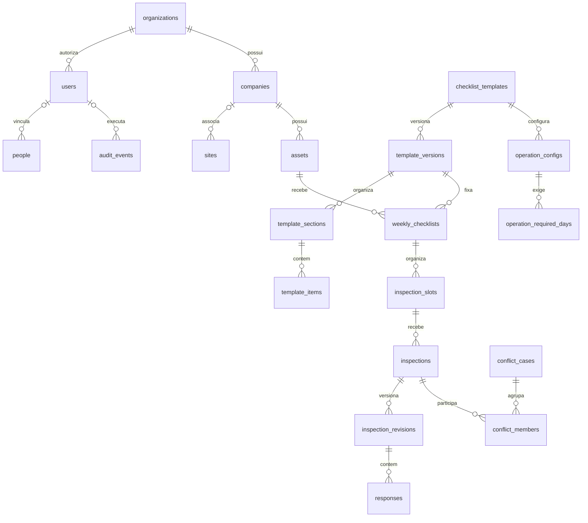

# Arquitetura e regras do sistema

## Organização do código

A plataforma usa Next.js, TypeScript, Drizzle e PostgreSQL. O aplicativo usa Flutter, Drift e SQLite3MultipleCiphers. Somente o servidor acessa o PostgreSQL.

```text
src/app/                         páginas e Route Handlers
src/features/<funcionalidade>/
  domain/                        schemas e regras
  application/                   serviços e casos de uso
  infrastructure/                persistência e integrações
  presentation/                  componentes web

mobile/lib/features/<funcionalidade>/
  domain/                        modelos e contratos
  application/                   coordenação dos casos de uso
  data/                          Drift, HTTP e repositórios
  presentation/                  telas e widgets
```

As funcionalidades web são `auth`, `users`, `registry`, `templates`, `checklists`, `sync`, `conflicts` e `audit`. As rotas HTTP permanecem em `src/app/api/`.

## Identidades distintas

| Registro        | Finalidade                                                           |
| --------------- | -------------------------------------------------------------------- |
| `users`         | Conta de acesso: nome, matrícula, hash de senha, perfis e situação   |
| `people`        | Pessoa identificada no formulário: motorista, operador ou supervisor |
| `organizations` | Escopo dos dados e da autorização                                    |

A matrícula é texto normalizado, com unicidade global no banco; o login não possui seletor de organização. O e-mail é opcional e mantido para contas antigas e integração OIDC.

O autor da ação vem da conta autenticada. Escolher outro motorista na identificação não altera o autor da inspeção.

## Principais relações



Os nomes físicos e campos completos estão em [schema.ts](../src/infrastructure/db/schema.ts). O diagrama é um resumo, não substitui as constraints do banco.

## Cadastros e modelos

- Empresas, locais, pessoas e ativos usam `active` para desativação.
- Local pode não estar vinculado a uma empresa; ativo exige empresa e admite local vazio.
- Ativos guardam revisões em `asset_revisions`.
- Modelos possuem versões, seções e itens. Uma publicação posterior não modifica a versão de semanas já abertas.
- Modelo publicado pode ser arquivado. Exclusão normal de rascunho depende de não haver histórico/referências.
- TE continua pendente de identificação no catálogo de origem; isso não garante sua existência em um banco específico.

## Semana e inspeção

A semana começa na segunda-feira. O fuso padrão do ambiente é `America/Fortaleza`. O checklist guarda o fuso usado na abertura; datas locais são `date`, e instantes são `timestamptz`.

A identidade de uma semana é `(organization_id, asset_id, template_id, week_start_date)`. Ao abrir, ela fixa a versão publicada e a configuração operacional.

Um slot é `(weekly_checklist_id, local_date, occurrence_no)`. A inspeção pertence a um slot e usa um UUID gerado antes do envio. A data deve estar na semana fixada, e a ocorrência respeita a configuração. Essas validações são realizadas na aplicação.

Cada revisão de inspeção guarda identificação, observações, anexos e autor. As respostas referenciam os itens da versão fixada. A identificação é um snapshot JSON dentro da revisão, não uma tabela separada.

A matriz semanal apresenta itens nas linhas e inspeções/datas nas colunas. Não há sete campos fixos de resposta no banco.

## Estados e validação

| Dimensão            | Valores                                                          |
| ------------------- | ---------------------------------------------------------------- |
| Preenchimento       | `DRAFT`, `COMPLETED`, `CORRECTED`, `VOIDED`                      |
| Sincronização local | `LOCAL_ONLY`, `QUEUED`, `SYNCING`, `SYNCED`, `CONFLICT`, `ERROR` |
| Resposta            | `null`, `C`, `NC`, `NA`                                          |

Concluir não significa que o servidor já recebeu os dados. A conclusão verifica os itens obrigatórios e observações exigidas para não conformidade. Fotos são opcionais no fluxo atual.

Uma inspeção concluída exige correção com justificativa para alteração no servidor. A anulação de inspeções já enviadas ainda não possui fluxo completo no aplicativo.

## Concorrência e idempotência

O servidor usa transações, locks e restrições únicas para proteger a criação de semanas, slots e inspeções. Inspeções possuem recibos por `(organization_id, device_id, operation_id)` e hashes de conteúdo.

Atualizações usam revisão base. Uma revisão desatualizada gera conflito, em vez de sobrescrever silenciosamente o registro.

Se dois aparelhos criarem inspeções distintas no mesmo slot, a segunda é preservada como candidata em um conflito. O servidor implementa as resoluções previstas no domínio; a interface atual apresenta a escolha de principal. Outras resoluções dependem da operação e da interface correspondente.

A outbox local mantém o conteúdo de uma operação já tentada. Alterações posteriores aguardam a confirmação e seguem em outra operação com a revisão retornada.

As garantias de idempotência variam por rota. A presença de `Idempotency-Key` não significa, sozinha, que toda rota cadastral mantém um recibo de resposta; consulte os handlers e repositórios correspondentes.

## Autorização

A API deriva a organização da identidade autenticada. `getAuthContext` consulta conta ativa e perfis atuais; `requirePermission` protege os casos e rotas que exigem uma permissão.

Os papéis implementados são:

| Papel              | Principais acessos                                              |
| ------------------ | --------------------------------------------------------------- |
| `ORG_ADMIN`        | Todas as permissões, incluindo administração de usuários        |
| `TEMPLATE_MANAGER` | Modelos, publicação, arquivamento e auditoria                   |
| `FLEET_MANAGER`    | Cadastros, modelos em leitura, inspeções e conflitos em leitura |
| `SUPERVISOR`       | Inspeções, correções, conflitos, auditoria e sincronização      |
| `INSPECTOR`        | Cadastros, leitura de modelos, preenchimento e sincronização    |
| `AUDITOR`          | Leitura de cadastros, modelos, inspeções e auditoria            |

A matriz exata fica em [permissions.ts](../src/features/auth/domain/permissions.ts). Não há tabela de atribuição de papéis por local nem garantia geral de que um inspetor só consulta suas próprias inspeções; o escopo implementado deve ser lido nas permissões e filtros dos serviços.

## Autenticação e auditoria

Senhas são hashes bcrypt. O painel usa sessão NextAuth em cookie HttpOnly, SameSite=Lax e Secure em produção. O aplicativo usa access token de 15 minutos e refresh token de 30 dias, com rotação e hash do refresh no servidor.

A redefinição de senha e mudanças de acesso revogam refresh tokens conforme o serviço de usuários. A invalidação completa de sessões web e access tokens existentes ainda é uma pendência.

A migração `0006_user_audit_names` adiciona:

- nome preservado em novos eventos (`actor_display_name`);
- nome preservado em revisões (`authored_display_name`);
- triggers de captura do nome e bloqueio de alteração/exclusão de eventos de auditoria.

O ID do autor permanece como referência estável. Eventos antigos sem snapshot de nome usam o nome atual como fallback identificado na interface. Eventos de manutenção podem ter autor de sistema, sem conta atribuída.

A auditoria registra operações recebidas no servidor. Salvamentos locais agrupados na outbox não geram um evento remoto por toque ou digitação.

## Offline e limites

O banco local mantém catálogos, semanas, inspeções, respostas, identificação, fotos e outbox. Sua chave e os tokens ficam no armazenamento seguro.

A aplicação funciona offline após o primeiro acesso e bootstrap. Novos cadastros são permitidos offline. O envio respeita dependências e mantém dados em falhas.

A recuperação completa de inspeções de outro aparelho, a troca entre contas e o tratamento completo de tombstones ainda estão pendentes. Consulte [Sincronização e limitações](mobile-contract-gaps.md).

## Exclusão excepcional de testes

A exclusão cotidiana é lógica. O script de manutenção para testes permite remoção física de dados operacionais de uma organização, preservando contas, auditoria e modelos cujo nome não contém `teste`.

A execução exige prévia correspondente, backup local e transação; não faz parte do fluxo normal do produto. Após a limpeza, aparelhos com dados de teste precisam ser limpos separadamente. Consulte [Operação e manutenção](operations.md).
